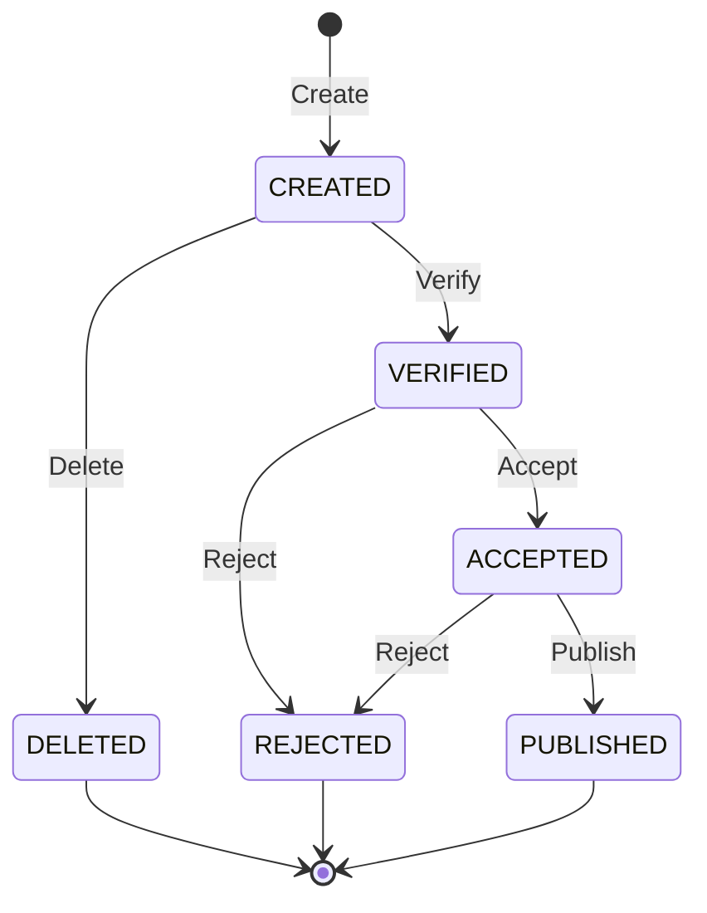
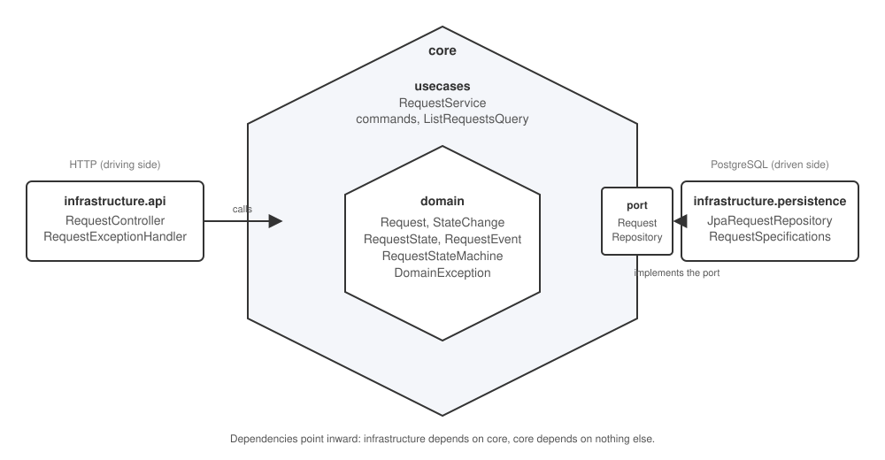

# Request Management API
 
Backend service managing the lifecycle of requests, where each request moves through a defined set of states governed by a state diagram. The functionality is exposed as a REST API; there is no GUI.

Status : all specifications implemented

Design decisions are documented in [ASSUMPTIONS.md](ASSUMPTIONS.md).

## State diagram



| From     | Event   | To        | Constraint                        |
|----------|---------|-----------|-----------------------------------|
| (none)   | Create  | CREATED   | name and content are mandatory    |
| CREATED  | Delete  | DELETED   | reason is mandatory               |
| CREATED  | Verify  | VERIFIED  |                                   |
| VERIFIED | Reject  | REJECTED  | reason is mandatory               |
| VERIFIED | Accept  | ACCEPTED  |                                   |
| ACCEPTED | Reject  | REJECTED  | reason is mandatory               |
| ACCEPTED | Publish | PUBLISHED | a unique publication number is assigned |

DELETED, REJECTED and PUBLISHED are terminal. The content can only be edited in CREATED or VERIFIED; editing does not change the state.

## Architecture

A simplified hexagonal architecture: the domain and the use cases form the core, the REST and JPA adapters sit outside, and the persistence adapter implements a port declared in the core.



Dependencies point inward: `infrastructure` depends on `core`, `core` depends on nothing else. Input ports and a separate persistence model are deliberately omitted at this size; see [ASSUMPTIONS.md](ASSUMPTIONS.md).

## Tech stack
 
- Java 25 and Spring Boot 4 (Web, Data JPA, Validation), springdoc for OpenAPI
- PostgreSQL 18, schema managed with Flyway
- JUnit 5, AssertJ, Mockito and Testcontainers for tests, JaCoCo for coverage
- Maven (wrapper included)

## Prerequisites
 
- JDK 25
- Docker, used both by Docker Compose (local database) and by Testcontainers (tests)

## Running the application
 
Start the database, then the application:
 
```bash
docker compose up -d
./mvnw spring-boot:run
```
 
The API is served on http://localhost:8080; Flyway applies the migrations on startup. The interactive API documentation is at http://localhost:8080/swagger-ui.html and the OpenAPI document at http://localhost:8080/v3/api-docs, both generated from the code by springdoc.
 
To stop the database (add `-v` to also delete its data):
 
```bash
docker compose down
```
 
## Running the tests
 
```bash
./mvnw clean test
```
 
Integration tests start their own PostgreSQL container through Testcontainers, so Docker must be running, but the Compose database is not needed.

The same command produces a JaCoCo coverage report in `target/site/jacoco/index.html`. Coverage is used to find untested paths

## API

| Method | Path                           | Body                  | Response                                      |
|--------|--------------------------------|-----------------------|-----------------------------------------------|
| POST   | `/requests`                    | `{"name", "content"}` | 201, `Location: /requests/{id}`, `{"id"}`     |
| GET    | `/requests`                    |                       | 200, page of requests (see parameters below)  |
| GET    | `/requests/{id}`               |                       | 200, full request                             |
| PUT    | `/requests/{id}/content`       | `{"content"}`         | 204 (CREATED or VERIFIED only)                |
| POST   | `/requests/{id}/verify`        |                       | 204, CREATED to VERIFIED                      |
| POST   | `/requests/{id}/accept`        |                       | 204, VERIFIED to ACCEPTED                     |
| POST   | `/requests/{id}/reject`        | `{"reason"}`          | 204, VERIFIED or ACCEPTED to REJECTED         |
| POST   | `/requests/{id}/delete`        | `{"reason"}`          | 204, CREATED to DELETED                       |
| POST   | `/requests/{id}/publish`       |                       | 200, `{"publicationNumber"}`, ACCEPTED to PUBLISHED |
| GET    | `/requests/{id}/history`       |                       | 200, state changes oldest first                     |

Listing parameters: `name` (partial match, case-insensitive), `state` (exact), `page` (0-based, default 0), `size` (default 10, maximum 100). Filters combine with AND; results are newest first.

```json
{
  "items": [ { "id": 3, "name": "Budget approval", "state": "VERIFIED", "...": "..." } ],
  "page": 0,
  "size": 10,
  "totalElements": 1,
  "totalPages": 1
}
```

Mutations return no representation; `GET /requests/{id}` returns the current state:

```json
{
  "id": 1,
  "name": "My request",
  "content": "Some content",
  "state": "VERIFIED",
  "reason": null,
  "publicationNumber": null
}
```

The history lists every state change, including the creation, oldest first:

```json
{
  "requestId": 1,
  "entries": [
    {"fromState": null, "toState": "CREATED", "event": "CREATE", "reason": null, "occurredAt": "2026-10-25T20:14:03.120Z"},
    {"fromState": "CREATED", "toState": "VERIFIED", "event": "VERIFY", "reason": null, "occurredAt": "2026-10-25T20:15:41.887Z"},
    {"fromState": "VERIFIED", "toState": "REJECTED", "event": "REJECT", "reason": "Incomplete content", "occurredAt": "2026-10-25T20:16:12.004Z"}
  ]
}
```

Examples:

```bash
curl -i -X POST localhost:8080/requests \
  -H 'Content-Type: application/json' \
  -d '{"name": "My request", "content": "Some content"}'
 
curl -i -X POST localhost:8080/requests/1/verify
 
curl -i -X POST localhost:8080/requests/1/reject \
  -H 'Content-Type: application/json' \
  -d '{"reason": "Incomplete content"}'
 
curl localhost:8080/requests/1
curl localhost:8080/requests/1/history
curl 'localhost:8080/requests?name=budget&state=VERIFIED&page=0&size=10'
```

### Errors

Errors are returned as RFC 9457 problem details (`application/problem+json`):

| Status | When                                                                                   |
|--------|----------------------------------------------------------------------------------------|
| 400    | Validation failure: missing or blank name, content or reason; malformed JSON; invalid listing parameters |
| 404    | No request with that id                                                                |
| 409    | Transition not allowed from the current state, content not editable, or concurrent modification |
| 500    | Unexpected error; the response carries no technical detail, the server log does        |

## Project structure

```
src/main/java/io/github/alexandrefilipiak/requestmanagement
    core
        domain            Request and StateChange entities, states, events, state machine, business exceptions
        usecases          RequestService, commands and the RequestRepository port
    infrastructure
        api               REST controller, response records, exception handler
        persistence       Spring Data JPA implementation of the port
src/main/resources/db/migration     Flyway migrations
src/test/java/...                   Tests and Testcontainers configuration
compose.yaml                        Local PostgreSQL
```
 